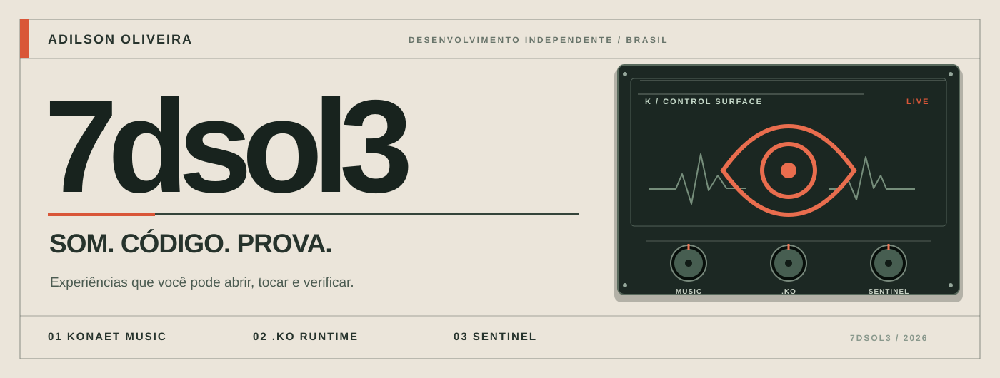

### Adilson Oliveira · `7dsol3`

Eu construo as interfaces e a máquina por trás delas. Aqui dá para **abrir o produto**, **mexer nos controles** e **conferir como funciona**.

[**Entrar no KONAET Music ↗**](https://7dsol3.github.io/konaet-music/) &nbsp;&nbsp; [**Executar .ko ↗**](https://konaet-ko-runtime.alkalipixie.chatgpt.site/console) &nbsp;&nbsp; [**Conhecer o Sentinel ↗**](https://7dsol3.github.io/konaet-sentinel/)

---

### 01 / Tocar — KONAET Music

Uma loja de instrumentos que também é bancada de experimentação. Você pode filtrar o catálogo, comparar modelos, testar uma cotação de demonstração e abrir o **Sound Lab** para tocar acordes, afinar e examinar áudio no próprio navegador. A aparência tem paletas, materiais e controles que você ajusta e salva localmente.

[Abrir a experiência](https://7dsol3.github.io/konaet-music/) · [Ir ao Sound Lab](https://7dsol3.github.io/konaet-music/sound-lab/) · [Examinar o código](https://github.com/7dsol3/konaet-music) · [Projeto H-01 de áudio digital](https://github.com/7dsol3/konaet-music/tree/main/hardware/h01-audio)

### 02 / Executar — `.ko` e Konaet Soberana

Contratos `.ko` passam por uma cadeia que você pode seguir: política, execução, estado e recibo. O console roda contratos no navegador; a especificação e os testes mostram onde cada garantia começa e termina.

[Executar .ko online](https://konaet-ko-runtime.alkalipixie.chatgpt.site/console) · [Começar com .ko](https://github.com/7dsol3/konaet-sovereign-spec/blob/main/KO-QUICKSTART.md) · [Ler a arquitetura](https://github.com/7dsol3/konaet-sovereign-spec/blob/main/ECOSYSTEM.md) · [Ver os resultados de validação](https://github.com/7dsol3/konaet-sovereign-spec/blob/main/VALIDATION-RESULTS.md)

### 03 / Inspecionar — Konaet Sentinel

Um sistema de análise comportamental para servidores de jogos. Regras e sinais organizam o caso para revisão; a decisão final continua com o operador. A apresentação e as provas ficam abertas para inspeção.

[Abrir o Sentinel](https://7dsol3.github.io/konaet-sentinel/) · [Ver o repositório](https://github.com/7dsol3/konaet-sentinel) · [Conferir provas e limites](https://7dsol3.github.io/konaet-sentinel/provas.html)

---

**Tem algo para construir junto?** [Converse comigo](https://wa.me/message/43CXZJ7NW2FPDO) ou [me encontre no LinkedIn](https://www.linkedin.com/in/adilson-oliveira-779490283/).

Documentação técnica que antes ocupava este perfil

O conteúdo anterior está preservado em [PROFILE-DETAILS.md](PROFILE-DETAILS.md). Os repositórios de cada produto guardam as versões e os testes atuais.

