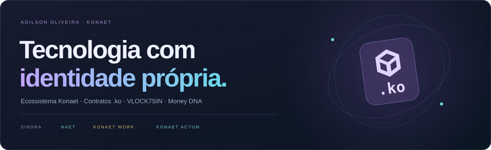
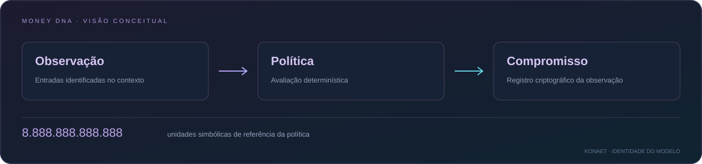

  

  
<strong>Ecossistema Konaet · Contratos .ko · VLOCK7SIN · Money DNA</strong>

  

    <a href="https://konaet-ko-runtime.alkalipixie.chatgpt.site">Conhecer a Konaet</a> ·
    <a href="https://konaet-ko-runtime.alkalipixie.chatgpt.site/console">Executar .ko online</a> ·
    <a href="https://wa.me/message/43CXZJ7NW2FPDO">Conversar sobre um projeto</a>
  

  

    <a href="https://github.com/7dsol3/konaet-sovereign-spec/blob/main/KO-QUICKSTART.md">Começar com .ko</a> ·
    <a href="https://github.com/7dsol3/konaet-sovereign-spec/blob/main/ECOSYSTEM.md">Guia do ecossistema</a> ·
    <a href="https://github.com/7dsol3/konaet-sovereign-spec/releases/latest">Aplicativo Windows</a>
    · <a href="https://7dsol3.github.io/konaet-sovereign-spec/">.ko Studio com estado e assinaturas</a>
  

## Konaet Soberana

Crio software, experiências digitais e tecnologia com identidade própria.
A Konaet reúne regras nativas `.ko`, infraestrutura VLOCK7SIN e ativos do
ecossistema em uma mesma visão de produto.

O console público permite escrever uma política `.ko`, enviar um contexto
e conferir o resultado das regras executadas no servidor. No perfil v6 do
VLOCK, a política participa da validação do evento e do estado da instância.

O **[.ko Studio](https://7dsol3.github.io/konaet-sovereign-spec/)** executa
contratos com funções tipadas, storage, mapas, eventos e chamadas Ed25519
na sessão do navegador. Exporte os recibos para verificá-los e reproduzi-los
no Node.js. A distribuição inclui chave cifrada e journal autenticado para
uso persistente no Node. [Criar seu contrato .ko](https://github.com/7dsol3/konaet-sovereign-spec/blob/main/KO-PROGRAM.md).

Nas **gêneses v7 e v8**, os validadores também executam os contratos `.ko`:
estado e recibos integram a raiz assinada pelo quórum. O console 1.8.0
inicia quatro processos, recupera o WAL e exporta recibos com certificado.
[Contratos no consenso VLOCK7SIN](https://github.com/7dsol3/konaet-sovereign-spec/blob/main/KO-CONSENSUS.md).

**Recibos para a Konaet Social:** `SocialReceiptRegistry.ko` registra
compromissos de eventos autorizados, mantendo o documento e seu salt fora
da cadeia. O SDK confere gênese, contrato, execução, inclusão e quórum.
[Integrar eventos e conferir recibos](https://github.com/7dsol3/konaet-sovereign-spec/blob/main/SOCIAL-RECEIPTS.md).

A [distribuição 1.8.0](https://github.com/7dsol3/konaet-sovereign-spec/releases/tag/v1.8.0)
inclui proveniência Sigstore assinada pela identidade do build, com bundle
para verificação. A `main` exige pull request e CI Windows/Linux aprovado.

### Konaet Polyglot Receipt Kit

**C · C++ · C# · Python · Rust · Perl · Go · Node.js · Shell**

O mesmo compromisso criptográfico, com todos os seus 256 bits preservados
em argumentos `.ko`. Nove entradas aprovadas no Linux, com vetores comuns,
limites de entrada e uma chamada real finalizada em quatro processos por job.
O verificador Node confere os certificados, que também ficam na distribuição.

| Integração | Recursos |
|---|---|
| Nativo | C11 com API pública, C++17 com RAII e Rust com dependências fixadas |
| Aplicações e serviços | C#, Python, Go, Perl e Node com inteiros exatos |
| Operação | Shell POSIX para o cliente C; entrada privada via stdin |
| Especificação | KRP-0001 em Wikitext e TeX, com formato e limites definidos |

[Código e comandos](https://github.com/7dsol3/konaet-sovereign-spec/tree/main/polyglot)
· [Matriz dos nove jobs](https://github.com/7dsol3/konaet-sovereign-spec/blob/main/polyglot/RESULTS.md)
· [Resultados reexecutáveis](https://github.com/7dsol3/konaet-sovereign-spec/tree/main/evidence/polyglot-2026-10-31)

Novas redes v8 reservam cotas de implantação para participantes autorizados.
A edição também acrescenta recuperação verificada de locks abandonados,
sincronização por índice e encerramento do console com prazo.
[Capacidade e recuperação](https://github.com/7dsol3/konaet-sovereign-spec/blob/main/RECOVERY.md).

**Homologação de uma hora concluída em quatro VMs reais:** 415 transferências,
138 chamadas `.ko` e 554 fechamentos, com a mesma raiz final. O roteiro
incluiu perda/retorno de quórum e recuperação após SIGKILL. Os hosts do
ensaio eram temporários, sob a mesma conta/provedor.
[Resultados e verificação dos relatos assinados](https://github.com/7dsol3/konaet-sovereign-spec/blob/main/VALIDATION-RESULTS.md).

O verificador permite fixar a gênese da rede e a raiz anterior esperadas,
obtidas por um canal confiável. Isso distingue um recibo consistente da
confirmação de que ele pertence à rede escolhida.

A distribuição inclui [gateway para eventos já assinados](https://github.com/7dsol3/konaet-sovereign-spec/blob/main/GATEWAY.md),
supervisão da malha mTLS, prontidão e [serviço Linux para operadores](https://github.com/7dsol3/konaet-sovereign-spec/blob/main/deploy/validator/README.md).
O teste integra quatro operadores locais, implantação, chamada, quórum e
recuperação. A operação contínua depende de instalar os serviços nos hosts
dos operadores.

## Ativos do ecossistema

| Identidade | Papel no sistema |
|---|---|
|  **SINDRA · SND** | Unidade nativa da gênese VLOCK7SIN, com regras `.ko` e nove casas decimais |
|  **Konaet NAET** | Unidade da aplicação, com saldos e operações no ledger Konaet |
|  **Konaet Work · KWRK** | Unidade de trabalho registrada no ecossistema |
|  **Konaet Actum · KACT** | Unidade ligada à execução contabilizada na aplicação |

## Money DNA

**8.888.888.888.888 unidades de referência da política.**

Esse número identifica a capacidade simbólica de referência do Money DNA,
que organiza observações e compromissos criptográficos. É uma referência
do modelo, distinta do saldo financeiro, da emissão e da cotação dos ativos.

## Projetos e parcerias

- **[Konaet Soberana](https://konaet-ko-runtime.alkalipixie.chatgpt.site)** — ecossistema, ativos e tecnologia nativa.
- **[Console .ko](https://konaet-ko-runtime.alkalipixie.chatgpt.site/console)** — compilação e execução de regras online.

## .ko para criar e executar

| Comece por aqui | O que você encontra |
|---|---|
| [Console no navegador](https://konaet-ko-runtime.alkalipixie.chatgpt.site/console) | Editor, contexto, importação e resultado de cada regra |
| [Seu primeiro projeto .ko](https://github.com/7dsol3/konaet-sovereign-spec/blob/main/KO-QUICKSTART.md) | Fonte e exemplos prontos, compilação e execução local ou online |
| [Referência da linguagem](https://github.com/7dsol3/konaet-sovereign-spec/blob/main/KO-RUNTIME.md) | Campos, operadores, fases, hashes e API |
| [Aplicativo Windows](https://github.com/7dsol3/konaet-sovereign-spec/releases/latest/download/Konaet-Console-Windows-x64.zip) | Console e quatro processos validadores de demonstração, com Node incluído |

O fluxo de trabalho permite criar um projeto, compilar a política, conferir
o artefato e executar os exemplos. O modo online confere se o programa
retornado pelo servidor corresponde ao hash compilado no pacote.

## Vamos construir

Integrações, aplicações sob medida e pesquisa orientada a produto começam
com um escopo claro: objetivo, dados, permissões, entregas e operação.

**[Falar com a Konaet sobre um projeto](https://wa.me/message/43CXZJ7NW2FPDO).**

Os diagramas apresentam recursos e fluxos de alto nível. Dados de contas,
chaves e configurações privadas pertencem à operação do sistema.

---

## Konaet Sentinel

  

  
<strong>Anti-cheat comportamental · IA explicável · Controle do operador</strong>

  

    <a href="https://github.com/7dsol3/konaet-sentinel">Repositório Sentinel</a> ·
    <a href="https://7dsol3.github.io/konaet-sentinel/">Site e teste de 30 dias</a> ·
    <a href="https://github.com/7dsol3/konaet-sentinel/releases/latest">Versão mais recente</a>
  

O Konaet Sentinel reúne análise comportamental, regras explicáveis e proteção
de efeitos em partida para servidores que você opera. O dashboard apresenta
os casos para revisão; confirmação de trapaça e banimento continuam sob
controle humano.

| Recurso | Como funciona |
|---|---|
| **Análise comportamental** | Sinais e regras ajudam o operador a examinar a telemetria do servidor |
| **Proteção em partida** | A malha confere condições antes de aplicar efeitos, quando integrada ao servidor |
| **Memória de casos** | Novos casos exigem confirmação humana e passam por gates antes da ativação |
| **Dashboard Windows** | Executável com interface, guia de integração e teste de 30 dias |
| **Verificação do pacote** | Os comandos `prove` e `audit` executam checagens e conferem os arquivos distribuídos |

Os perfis precisam de integração com o servidor autorizado. A proteção não
remove programas do computador do atacante nem equivale a integração oficial
com anti-cheats dos jogos. Os relatórios identificam os cenários sintéticos e
as condições dos testes.

### Conhecer e usar o Sentinel

- **[Repositório do projeto](https://github.com/7dsol3/konaet-sentinel)** — apresentação, instruções e arquivos públicos.
- **[Site e download do teste](https://7dsol3.github.io/konaet-sentinel/)** — pacote Windows e início de uso.
- **[Central de provas](https://7dsol3.github.io/konaet-sentinel/provas.html)** — relatórios e verificações do motor.
- **[Documentação e licença](https://7dsol3.github.io/konaet-sentinel/legal.html)** — integração, condições de uso e informações do pacote.
- **[Contato da Konaet](https://wa.me/message/43CXZJ7NW2FPDO)** — projetos, integração e suporte.

O repositório público do Sentinel apresenta o produto e seus downloads;
o código-fonte do motor é privado.
