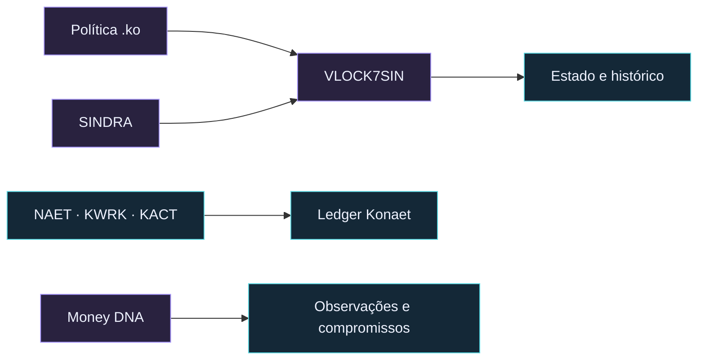

  

  
<strong>Ecossistema Konaet · Contratos .ko · VLOCK7SIN · Money DNA</strong>

  

    <a href="https://konaet-ko-runtime.alkalipixie.chatgpt.site">Conhecer a Konaet</a> ·
    <a href="https://konaet-ko-runtime.alkalipixie.chatgpt.site/console">Executar .ko online</a> ·
    <a href="https://wa.me/message/43CXZJ7NW2FPDO">Conversar sobre um projeto</a>
  

## Konaet Soberana

Crio software, experiências digitais e tecnologia com identidade própria.
A Konaet reúne regras nativas `.ko`, infraestrutura VLOCK7SIN e ativos do
ecossistema em uma mesma visão de produto.

O console público permite escrever uma política `.ko`, enviar um contexto
e conferir o resultado das regras executadas no servidor. No perfil v6 do
VLOCK, a política participa da validação do evento e do estado da instância.

## Ativos do ecossistema

| Identidade | Papel no sistema |
|---|---|
| **SINDRA · SND** | Unidade nativa da gênese VLOCK7SIN, com regras `.ko` e nove casas decimais |
| **Konaet NAET** | Unidade da aplicação, com saldos e operações no ledger Konaet |
| **Konaet Work · KWRK** | Unidade de trabalho registrada no ecossistema |
| **Konaet Actum · KACT** | Unidade ligada à execução contabilizada na aplicação |

## Money DNA

**8.888.888.888.888 unidades de referência da política.**

Esse número identifica a capacidade simbólica de referência do Money DNA,
que organiza observações e compromissos criptográficos. É uma referência
do modelo, distinta do saldo financeiro, da emissão e da cotação dos ativos.

## Projetos e parcerias

- **[Konaet Soberana](https://konaet-ko-runtime.alkalipixie.chatgpt.site)** — ecossistema, ativos e tecnologia nativa.
- **[Console .ko](https://konaet-ko-runtime.alkalipixie.chatgpt.site/console)** — compilação e execução de regras online.
- **[Konaet Sentinel](https://7dsol3.github.io/konaet-sentinel/)** — ferramentas de segurança para servidores de jogos.

Integrações, aplicações sob medida e pesquisa orientada a produto começam
com um escopo claro: objetivo, dados, permissões, entregas e operação.

**[Falar com a Konaet sobre um projeto](https://wa.me/message/43CXZJ7NW2FPDO).**

Os diagramas apresentam recursos e fluxos de alto nível. Dados de contas,
chaves e configurações privadas pertencem à operação do sistema.

Konaet Sentinel — apresentação e informações do projeto

  

### Software independente

Construo anti-cheat, ferramentas de jogo e sistemas que mostram a evidência
antes de pedir confiança. A estética é calma; a engenharia é verificável.

## Em destaque

**[Konaet Sentinel](https://7dsol3.github.io/konaet-sentinel/)** — anti-cheat
comportamental para servidores que você opera. Regras físicas, 17 sinais
explicáveis, escudo que reduz o efeito da trapaça em quem joga limpo e
banimento manual por máquina. Sem ban automático.

- **Memória sob confirmação:** um caso revisado por humano entra no motor em
  211 ms (mediana), com gates de falso positivo e rollback. O sistema não
  aprende sozinho; o limite fora de distribuição está publicado.
- [Site e teste de 30 dias](https://7dsol3.github.io/konaet-sentinel/)
- [Central de provas](https://7dsol3.github.io/konaet-sentinel/provas.html) —
  benchmark, robustez, aprendizado confirmado, comparativo de arquitetura e
  `audit` verificável.
- [Release 1.3.0](https://github.com/7dsol3/konaet-sentinel/releases/tag/v1.3.0)
  — pacote trial com `HASHES.txt`; o `audit` recalcula modelo, gates, memória e
  binário.
- [Documentos, limites e licença](https://7dsol3.github.io/konaet-sentinel/legal.html)
- [Benchmark](https://7dsol3.github.io/konaet-sentinel/assets/benchmark.json),
  [robustez de rede](https://7dsol3.github.io/konaet-sentinel/assets/robustness.json)
  e [prova de aprendizado](https://7dsol3.github.io/konaet-sentinel/assets/adaptation.json)
  publicados, com o aviso sintético dentro dos arquivos.
- Código-fonte privado; o pacote público contém apenas executável e documentos.

## Como trabalho

**Evidência antes da claim.** Um resultado só existe quando um teste
reproduzível o sustenta. Dataset sintético é rotulado como sintético.

**Limites declarados.** Nenhum anti-cheat pega todos os cheats. O trial não é
um DRM inquebrável. O ban por máquina é um hash com decisão humana, não
atestação de GPU.

**Design sem ruído.** Liquid glass, tipografia editorial e movimento discreto.
A interface existe para deixar a decisão clara, não para parecer tecnologia.

## Stack

`Python` · `Ed25519` · `SHA-256` · `HTML/CSS` · `Playwright` · `PyInstaller`

## Contato

- Site: <https://7dsol3.github.io/konaet-sentinel/>
- WhatsApp: [Konaet](https://wa.me/message/43CXZJ7NW2FPDO)
- Brasil

