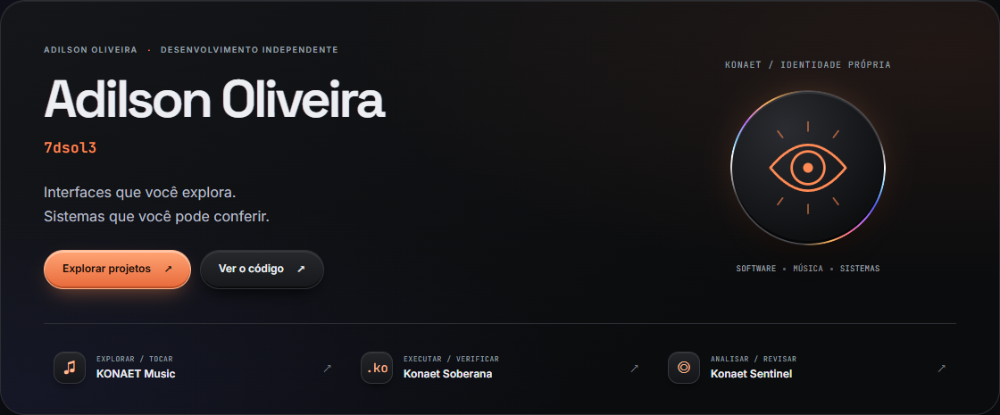

  <a href="https://7dsol3.github.io/7dsol3/"><strong>Abrir o perfil interativo ↗</strong></a> ·
  <a href="https://7dsol3.github.io/konaet-music/">KONAET Music</a> ·
  <a href="https://7dsol3.github.io/konaet-sovereign-spec/">.ko Studio</a> ·
  <a href="https://7dsol3.github.io/konaet-sentinel/">Sentinel</a>

Sou **Adilson Oliveira**, desenvolvedor dos projetos Konaet. Trabalho nas interfaces e nos sistemas por trás delas: música no navegador, contratos `.ko` e ferramentas de análise para jogos.

| Projeto | Experimente e confira |
| --- | --- |
| **[KONAET Music](https://7dsol3.github.io/konaet-music/)** | Catálogo, comparação, cotação de demonstração e [Sound Lab](https://7dsol3.github.io/konaet-music/sound-lab/) com acordes e análise local de áudio. [Código ↗](https://github.com/7dsol3/konaet-music) |
| **[Konaet Soberana](https://7dsol3.github.io/konaet-sovereign-spec/)** | Contratos `.ko`, execução, estado, assinaturas e recibos. [Console online](https://konaet-ko-runtime.alkalipixie.chatgpt.site/console) · [Especificação ↗](https://github.com/7dsol3/konaet-sovereign-spec) |
| **[Konaet Sentinel](https://7dsol3.github.io/konaet-sentinel/)** | Sinais comportamentais para revisão em servidores de jogos. [Provas e limites](https://7dsol3.github.io/konaet-sentinel/provas.html) · [Código ↗](https://github.com/7dsol3/konaet-sentinel) |

O [perfil interativo](https://7dsol3.github.io/7dsol3/) usa o **Prisma Pack** como referência: a luz da borda segue o cursor, e os controles ajustam brilho, espessura e movimento.

**Contato:** [Conversar sobre um projeto](https://wa.me/message/43CXZJ7NW2FPDO) · [LinkedIn](https://www.linkedin.com/in/adilson-oliveira-779490283/)

Documentação, relatórios e detalhes do ecossistema Konaet

A documentação que estava neste perfil foi preservada em [TECHNICAL-PROFILE.md](TECHNICAL-PROFILE.md), incluindo contratos, VLOCK7SIN, Polyglot Receipt Kit, validações, releases e ativos do ecossistema.

[Começar com .ko](https://github.com/7dsol3/konaet-sovereign-spec/blob/main/KO-QUICKSTART.md) · [Guia do ecossistema](https://github.com/7dsol3/konaet-sovereign-spec/blob/main/ECOSYSTEM.md) · [Resultados de validação](https://github.com/7dsol3/konaet-sovereign-spec/blob/main/VALIDATION-RESULTS.md)

